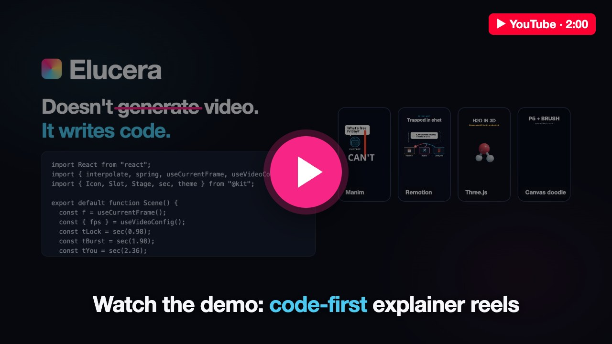
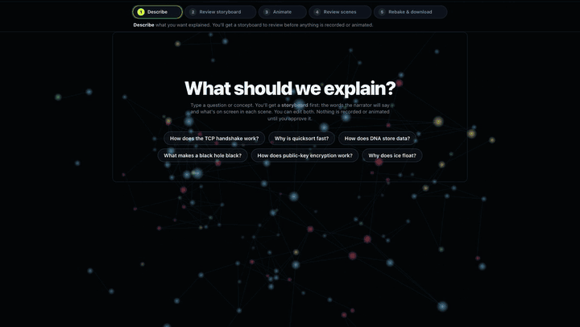
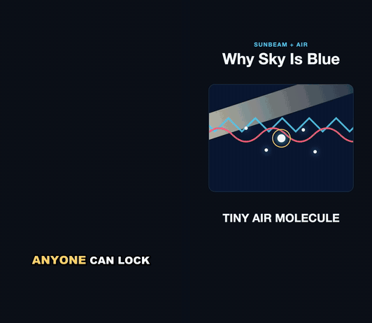
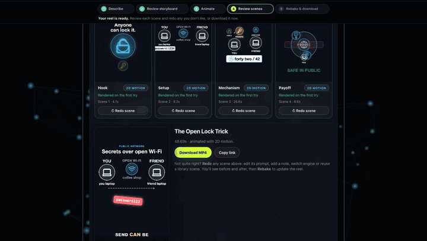

<div align="center">

# Elucera

### Explainer reels built from **code**, not slop.

Type a question. Get a captioned, narrated 1080×1920 reel where every frame is rendered from code the AI wrote:
legible text, correct diagrams, and every scene editable.

[](https://github.com/RDX-Rajat-Savdekar/Elucera/actions/workflows/ci.yml)


<a href="https://youtu.be/Rhlk5lkfOVk"></a>

**▶ [Watch the 2-minute demo on YouTube](https://youtu.be/Rhlk5lkfOVk)**

</div>

---

## Watch it build

<div align="center">


<sub>A real run, sped up: <i>“How does public-key encryption work?”</i> → storyboard → 4 scenes code and render themselves → reel ready in about 3 minutes.</sub>
</div>

## Why code-first?

Most AI video tools generate pixels. Elucera generates **programs**, then renders them.

| | Generative video (Sora, Veo) | Stock-footage tools | Human animator | **Elucera** |
|---|---|---|---|---|
| Correct diagrams and labels | ✕ hallucinated | ✕ generic | ✓ | **✓ rendered from code** |
| Fix one scene | ✕ regenerate everything | partly | ✓ slow | **✓ redo just that scene** |
| Cost per finished minute | $6–42 | $0.12–0.15 | $1,000–10,000 | **≈ $0.26** |

<sub>Competitor prices and sources: <code>elucera/costs.py</code>. Elucera cost measured on a real 49 s reel at Muse list price, including TTS, render compute and the Remotion license.</sub>

## Four engines, one director

The director model picks the right engine for each scene and writes its code. Each scene renders sandboxed and fixes itself from its own errors.

<div align="center">


<sub><b>Manim</b> (3Blue1Brown-style math) · <b>Remotion</b> (kinetic type and diagrams) · <b>Three.js</b> (3D) · <b>Canvas doodle</b> (p5 + GSAP)</sub>
</div>

## What it makes

<div align="center">


<sub>Straight out of the pipeline: voiceover, word-synced captions and animation, with no hand editing. Full videos are in <a href="demos/"><code>demos/</code></a>.</sub>
</div>

## Fix one scene, not the whole video

<div align="center">


<sub>Every scene is code, so you can edit its prompt, leave a note, switch engines or reuse a library clip, then rebake. The rest of the reel stays as it is.</sub>
</div>

---

## How it works

Topic in, 1080x1920 captioned explainer Reel out. See `GEMINI.md` for the project brief.

```
topic → script (Muse Spark) → voiceover (Gemini TTS) + word timings (faster-whisper)
      → scene plan (Muse picks manim | remotion | three per segment, beats timed to words)
      → per-segment code-gen → validate → render, self-fixing up to 3×, fallback card
      → ffmpeg: fit clips, concat, mux narration, burn word-highlight captions
```

## Setup (macOS)

```bash
brew install node ffmpeg-full colima docker
colima start --cpu 6 --memory 8
docker pull manimcommunity/manim:stable
uv sync
(cd remotion && npm install)
cp .env.example .env   # fill MUSE_API_KEY, GEMINI_API_KEY
```

`ffmpeg-full` is required (the plain formula lacks libass, which burns the captions). Paths to `ffmpeg`, `node`
and `docker` are configurable in `.env` (see `elucera/config.py`).

## Usage

```bash
uv run elucera make "how does the TCP handshake work"     # → outputs/<slug>/final.mp4
uv run elucera render-scene tests/fixtures/sample_2d.tsx  # test a hand-written scene (.py = Manim)
uv run elucera voice "Some narration"                     # TTS + word timings
uv run uvicorn elucera.api:app                            # POST /jobs {"topic"}, GET /jobs/{id}, GET /jobs/{id}/video
uv run pytest
```

Each job directory keeps `script.json`, `audio.json`, `plan.json`, every generated scene attempt
(`segN_tryK.py|.tsx`) and `results.json`, which is the place to look when tuning prompts.

## Asset library (`library/`)

Every run builds on the previous ones:

- Each scene that renders is saved to `library/scenes/<id>/` (code, `meta.json`, `thumb.png`, `clip.mp4`).
- Each finished reel is saved to `library/reels/<job>/` (script, plan, results, `strip.png`, `final.mp4`).
- Each error the self-fix loop got past is recorded in `library/lessons.jsonl`.
- Coder prompts automatically include the 1–2 most similar past scenes for the same renderer, plus the known pitfalls.

```bash
uv run elucera library list [--renderer three]   # browse (thumbnails in library/scenes/*/thumb.png)
uv run elucera library star <id>                 # prefer a great scene as an example
uv run elucera library rm <id>                   # drop a bad one so it is never imitated
uv run elucera library lessons                   # pitfalls fed to the coders
uv run elucera library add-lesson manim "<error>" --note "<how to avoid>"
uv run elucera library import outputs/<job>      # backfill from an old job directory
```

Code, metadata, lessons and thumbnails are committed to git; `.mp4` files stay local (gitignored).
Set `USE_LIBRARY=false` in `.env` for a clean-slate run.

## Layout

- `elucera/agents/` — script writer, scene planner, per-renderer coders + the render/fix loop (`coders/base.py`)
- `elucera/prompts/` — all LLM prompts; `kit.md` documents the Remotion component kit for the coder
- `elucera/render/` — Manim (Docker, no network) and Remotion (host Chromium) renderers, fallback card
- `elucera/audio/`, `elucera/assemble/` — TTS, alignment, captions, ffmpeg
- `remotion/` — Remotion project: `src/kit/` house components, `render.mjs`, `validate.mjs` (import allowlist,
  banned non-deterministic APIs, esbuild + tsc check)

## Safety model

Scene code is written by a model from a user-supplied topic, so treat it as untrusted (prompt injection is possible).

- **Manim (Python)** runs only inside `docker run --network none --cap-drop ALL --read-only` with CPU/memory/pid
  limits and no-new-privileges; only the scene's work dir and small tmpfs scratch dirs are writable. The AST
  import/call/dunder blocklist in `manim_renderer.py` catches mistakes early but is not a sandbox — the container is.
- **Seek (HTML)** renders in headless Chromium with its sandbox on. With Playwright installed (preferred), the page
  is served from a fake https origin and every request except the pinned CDN scripts is aborted; the plain Chrome
  CLI fallback only resolves `cdn.jsdelivr.net`. Validation rejects non-pinned URLs, local paths, frames and
  network APIs.
- **Remotion / Three (TSX)** passes an import allowlist plus a regex denylist (network, storage, other windows),
  then renders in Remotion's headless Chromium sandbox. That browser still has network access (drei and fonts can
  fetch), so the denylist is the only network gate for these scenes: a determined injected scene could make
  outbound requests. Run renders on a machine without secrets in reach of the browser if that matters to you.
- **Interactive 3D previews** (`…/player`) are served with `Content-Security-Policy: sandbox allow-scripts` and
  embedded in a sandboxed iframe, so scene code gets an opaque origin: no access to the app's DOM, storage or API.

## Deploying beyond localhost

`uvicorn` binds to `127.0.0.1` by default. Before exposing the server, set `API_TOKEN` in `.env`: every request
then needs `Authorization: Bearer <token>` (or the `X-Elucera-Token` header); for the web UI, open
`http://host:8000/?token=<token>` once to get a cookie. The `X-Elucera-User` browser id only separates chat
histories; it is not authentication.
